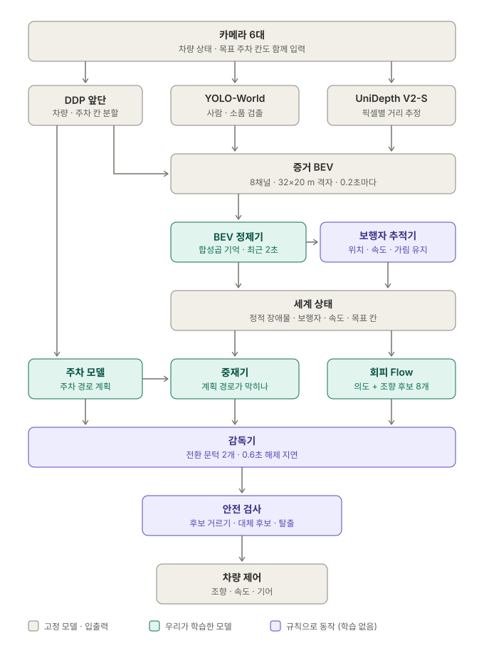

# Flow Parking System

CARLA 주차장에서 보행자와 소품을 피하면서 목표 칸에 주차하는 시스템입니다. 카메라 6대의 영상으로 차 주변의 조감도(BEV)를 만들고, 그 위에서 주차와 회피를 결정합니다.

주차 경로를 계획하는 모델과 방해물을 피하는 모델을 따로 두고, 지금 누가 운전할지를 학습한 중재기가 판단합니다. 이 저장소만으로 돌아가며, 따로 필요한 것은 CARLA뿐입니다.



- **회색:** 가져다 쓰는 고정 모델과 입출력
- **청록:** 이 저장소에서 학습한 모델 4개 (BEV 정제기, 주차 모델, 중재기, 회피 Flow)
- **보라:** 학습 없이 규칙으로 동작하는 부분 (보행자 추적기, 감독기, 안전 검사)

## 모듈이 하는 일

데이터가 흐르는 순서대로, 주변을 파악하는 부분, 무엇을 할지 정하는 부분, 실행하는 부분으로 나뉩니다.

### 1. 주변을 파악하는 부분

- **카메라 6대:** 차 둘레 여섯 방향을 찍습니다. 차량 상태(속도, 조향, 기어)와 목표 주차 칸도 함께 입력으로 들어갑니다.
- **DDP 앞단 (고정 모델):** 카메라 6장을 위에서 내려다본 그림으로 바꿔 차량과 주차 칸의 위치를 표시합니다. 주차 모델이 읽는 특징도 여기서 나옵니다.
- **YOLO-World (고정 모델):** 이미지에서 사람과 소품(고깔, 쓰레기통 등)을 찾습니다. 찾을 물체를 글자로 지정할 수 있어서 따로 학습하지 않았습니다.
- **UniDepth V2-S (고정 모델):** 픽셀마다 카메라에서 얼마나 떨어져 있는지 추정합니다. 이 거리가 있어야 이미지 속 사람과 소품을 차 주변 바닥의 위치로 옮길 수 있습니다.
- **증거 BEV:** 세 모델의 결과를 차 주변 32×20 m 격자(한 칸 10 cm) 한 장에 모읍니다. "바닥이 보인 칸", "무언가 서 있는 칸", "사람으로 검출된 칸" 같은 8개 층으로 되어 있고 0.2초마다 만듭니다. 아직 거친 상태라 가짜와 빠진 것이 섞여 있습니다.
- **BEV 정제기 (학습):** 거친 증거를 믿을 수 있는 지도로 다듬습니다. 최근 2초의 증거를 같이 읽어서, 방금 보였다가 가려진 것도 반영합니다. 정적 장애물, 보행자, 보행자의 속도를 냅니다.
- **보행자 추적기 (규칙):** 정제기가 낸 보행자 덩어리를 사람 목록(위치와 속도)으로 바꿉니다. 카메라가 못 보는 차 옆 사각지대로 들어간 사람을 잠깐 유지하고, 한 프레임만 나타난 가짜는 걸러 냅니다.
- **세계 상태:** 위 결과를 모은 것으로, 아래 모듈들이 공통으로 읽습니다. 정적 장애물 지도, 보행자 목록, 목표 칸이 들어 있습니다.

### 2. 무엇을 할지 정하는 부분

- **주차 모델 (학습):** 목표 칸까지의 주차 경로를 1.6초마다 계획합니다. 경로를 스플라인 계수로 내고, 이것을 점들의 경로로 풉니다(전진·후진 구간마다 64점, 최대 두 구간). 길 위의 소품이나 걸어오는 보행자는 고려하지 못합니다.
- **회피 Flow (학습):** 보행자나 소품을 피하는 운전을 합니다. 0.2초마다 두 단계로 출력합니다.
  1. 의도를 고릅니다. 주차 시작 위치로 가기, 대기, 전진하며 좌/우로 돌아가기, 후진하며 좌/우로 비키기, 뒤로 물러나기, 앞으로 벗어나기의 8가지입니다.
  2. 그 의도에 맞는 앞으로 0.8초의 조향·속도·기어를 0.2초 간격 4스텝으로 냅니다. 확률이 높은 의도 두 개에서 4개씩, 후보 8개가 나옵니다.

  의도를 먼저 정하는 이유는 왼쪽으로 피하기와 오른쪽으로 피하기가 섞여 가운데로 가 버리는 것을 막기 위해서입니다.
- **중재기 (학습):** 지금 주차 모델에 맡겨도 되는지 판단합니다. 세계 상태와 주차 모델의 계획 경로를 읽고, 이 경로대로 3초 가면 보행자와 겹칠 확률과 소품과 겹칠 확률을 냅니다.

### 3. 실행하는 부분

- **감독기 (규칙):** 중재기의 확률을 받아 누가 운전할지 실제로 바꿉니다.
  - 확률이 0.5를 넘으면 회피 Flow로 넘깁니다.
  - 0.3 아래로 0.6초 동안 유지되면 풀어 줍니다.
  - 풀린 뒤에도 차가 주차 시작 위치에 나란히 설 때까지는 회피 Flow가 계속 운전합니다.

  문턱을 둘로 나눈 이유는 경계에서 0.2초마다 왔다 갔다 하는 것을 막기 위해서입니다.
- **안전 검사 (규칙):** 회피 Flow의 후보를 하나씩 미리 굴려 보고(0.8초 주행 + 제동), 장애물이나 보행자와 겹치지 않는 첫 후보를 실행합니다.
  - 후보 8개가 모두 위험하면 나머지 의도의 후보를 차례로 시도합니다.
  - 그래도 없으면 정지합니다.
  - 차가 이미 소품에 살짝 닿아 선 경우에는 겹침이 더 깊어지지 않는 움직임을 허용해서 빠져나오게 합니다.
- **차량 제어:** 최종 조향·가감속·기어를 차에 넣습니다. 주차 모델이 운전할 때는 계획 경로를 따라가는 추종기가 조향을 만들고, 회피 Flow가 운전할 때는 Flow가 낸 조향과 속도를 그대로 씁니다.

### 한 번의 결정이 흐르는 순서 (0.2초마다)

1. 카메라 6장으로 세계 상태를 만듭니다.
2. 중재기가 주차 모델의 계획 경로가 막히는지 봅니다.
3. 감독기가 누가 운전할지 정합니다.
4. 주차 모델 차례면 경로를 따라갑니다. 회피 Flow 차례면 후보를 내고 안전 검사를 통과한 것을 실행합니다.

요약하면 주차 모델은 어디로 주차할지, 회피 Flow는 방해물을 어떻게 피할지, 중재기와 감독기는 지금 둘 중 누구 차례인지를 맡습니다. 인식 부분은 이들이 같은 지도를 보게 해 줍니다.

## 시뮬레이터에서 직접 읽는 값

카메라에서 나오지 않고 시뮬레이터가 알려 주는 값을 쓰는 곳이 있습니다.

- **차의 위치·방향·속도와 목표 칸의 위치.** 위치 추정은 이 시스템의 범위 밖입니다.
- **주차 계획의 검사.** 주차 모델이 낸 경로 후보를 실제 장애물 위치(주차된 차, 소품, 기둥)에 대 보고, 부딪히지 않는 것을 고릅니다. 통과하는 후보가 없으면 경로 최적화기가 대신 계획합니다.
- **안전 검사 (기본 설정).** 회피 Flow의 후보를 실제 장애물과 보행자 위치로 검사합니다. `SCREEN=perceived`로 실행하면 카메라로 만든 세계 상태로 검사합니다.

중재기와 회피 Flow가 읽는 세계 상태는 카메라에서만 나옵니다.

## 모듈과 파일

파일 경로는 `scripts/` 기준이고, `weights/`와 `third_party/`는 저장소 맨 위에 있습니다.

| 모듈 | 구분 | 파일 | 가중치 | 파라미터 수 |
|---|---|---|---|---|
| DDP 앞단 | 고정 | `ddp_frontend/` | `weights/ddp_frontend.pt` (Release에서 받음) | 108,319,459 |
| UniDepth V2-S | 고정 | `open_frontend/depth_models.py`, `third_party/UniDepth/` | 처음 실행할 때 자동으로 받음 | 34,184,323 |
| YOLO-World | 고정 | `open_frontend/models.py` | `weights/yolov8s-worldv2-carla.pt` | 12,759,880 |
| 증거 BEV | 계산 | `structure_flow/bev_evidence.py`, `open_frontend/frontend.py`, `geometry.py`, `tracker.py` | | |
| BEV 정제기 | 학습 | `structure_flow/bev_refiner.py` | `weights/bev_refiner.pt` | 3,363,108 |
| 보행자 추적기 | 규칙 | `structure_flow/bev_perceived.py` (`People`) | | |
| 세계 상태 | 계산 | `structure_flow/bev_perceived.py` (`Perception`), `bev_flow.py` (`bev_truth`), `bev_truth.py` (격자 정의) | | |
| 주차 모델 | 학습 | `structure_flow/model.py`, `config.py`, `labels.py`, `plan_server.py`, `model_server.py`, `sync_flow/`, `k4_flow_solver/` | `weights/parking_model.pt` | 2,758,857 |
| 회피 Flow | 학습 | `structure_flow/bev_flow.py`, `bev_flow_data.py`, `bev_flow_runtime.py` | `weights/avoidance_flow.pt` | 2,559,178 |
| 중재기 | 학습 | `structure_flow/bev_arbiter.py`, `bev_arbiter_data.py` | `weights/arbiter.pt` | 755,730 |
| 감독기 | 규칙 | `structure_flow/supervisor.py` (`FlowDriver`), `relevance.py` (계획 경로를 따라 차의 위치 예측) | | |
| 안전 검사 | 규칙 | `structure_flow/safety.py` (차량 운동 모델, 후보 검사) | | |
| 차량 제어 | 규칙 | `structure_flow/drive.py` (CARLA 주행 루프), `benchmark.py` (`Tracker` 추종기) | | |

전체 파라미터는 약 1억 6,470만 개이고, 그중 이 저장소에서 학습한 것은 9,436,873개입니다.

나머지 파일은 모델을 띄우는 서버와 시험 장면입니다.

- `structure_flow/system_server.py`: 인식, 중재기, 회피 Flow, 안전 검사를 GPU에서 돌리는 서버입니다.
- `structure_flow/scene_server.py`, `detour.py`, `detour_route.py`, `detour_drive.py`: 에피소드마다 주차 칸, 소품, 보행자를 배치하고, 주차 모델의 계획을 검사해 주행 루프에 전달합니다.
- `structure_flow/scenes.py`, `scene_contract.py`, `social_force.py`: 시험 장면의 보행자가 어디서 언제 어떻게 걷는지 정합니다.
- `data/`: 장면에 놓는 소품 목록과 보행자 장면 설정입니다.

## 실행

### 준비

1. **CARLA 0.9.11**을 받아 서버를 켭니다([CARLA 릴리스](https://github.com/carla-simulator/carla/releases/tag/0.9.11)).
2. **DDP 앞단 가중치**를 받습니다. 434 MB라 git의 파일 크기 한도를 넘어서 [Release v1.0](https://github.com/kang-jun-mo12/flow-parking-system/releases/tag/v1.0)에 있습니다. SHA-256은 `556bab3150757fe01c11f2d4cf0030183620727f545a1c2386cbfcc4738dfdd5`입니다.

   ```bash
   curl -L -o weights/ddp_frontend.pt https://github.com/kang-jun-mo12/flow-parking-system/releases/download/v1.0/ddp_frontend.pt
   ```

3. **Python 환경 두 개**를 준비합니다. 모델 프로세스는 Python 3.11(`requirements.txt`), CARLA 클라이언트는 Python 3.7(numpy, pillow)입니다. CARLA 0.9.11의 egg가 Python 3.7 전용이기 때문입니다.

나머지 앞단은 손댈 것이 없습니다. YOLO-World 가중치(`weights/yolov8s-worldv2-carla.pt`)와 UniDepth 코드(`third_party/UniDepth/`)는 저장소에 들어 있고, UniDepth 가중치(131 MB)는 처음 실행할 때 Hugging Face에서 자동으로 받습니다.

### 주행

```bash
CARLA_EGG=path/to/carla-0.9.11-py3.7-win-amd64.egg PY311=python PY37=python3.7 ./run_system.sh runs/demo 2000
```

`run_system.sh`는 프로세스 4개를 띄우고 에피소드 하나를 주행합니다. 결과는 `runs/demo/` 아래 에피소드 폴더의 `meta.json`(결과)과 `frames.json`(10 Hz 기록)에 남습니다.

| 프로세스 | 하는 일 |
|---|---|
| `system_server.py` | 인식(증거 BEV, 정제기, 보행자 추적기), 중재기, 회피 Flow, 안전 검사 |
| `model_server.py` | 주차 모델 |
| `scene_server.py` | 장면 구성, 주차 계획 검사와 전달 |
| `drive.py` | CARLA 클라이언트: 카메라, 감독기, 추종기, 차량 제어 |

## 출처

앞단 세 모델은 다른 분들이 공개한 것을 그대로 쓰며, 각자의 라이선스를 따릅니다.

- **DDP 앞단:** [Dino-Diffusion Parking](https://huggingface.co/ChampagneAndfragrance/Dino_Diffusion_Parking)의 공개 체크포인트(MIT)에 맞춰 다시 만든 모델입니다. `ddp_frontend.pt`는 그 체크포인트에서 앞단 부분만 꺼낸 것이고, 동작은 저자들의 공개 저장소를 따랐습니다. 주차 모델과 DDP 평가 방식은 [dino-flow-parking](https://github.com/kang-jun-mo12/dino-flow-parking)에 정리되어 있습니다.
- **YOLO-World:** [ultralytics](https://github.com/ultralytics/ultralytics)의 구현과 가중치입니다(AGPL-3.0). `weights/yolov8s-worldv2-carla.pt`는 `yolov8s-worldv2.pt`에 `open_frontend/models.py`의 `CARLA_PROMPTS` 어휘를 넣어 저장한 것이고, 같은 라이선스를 따릅니다.
- **UniDepth V2:** [lpiccinelli-eth/UniDepth](https://github.com/lpiccinelli-eth/UniDepth)의 코드를 고치지 않고 `third_party/UniDepth/`에 옮겼습니다(CC BY-NC 4.0, 비상업적 이용). 옮긴 커밋은 `third_party/UniDepth/SOURCE.md`에 적혀 있습니다.
